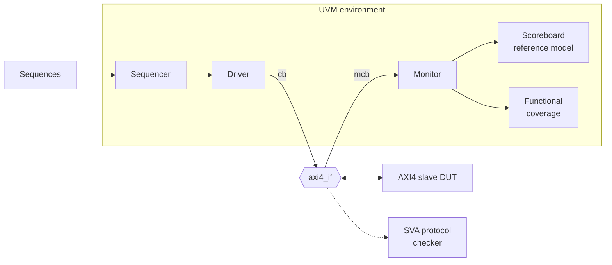

# AXI4 Slave UVM Verification

A full AXI4 slave (not AXI4-Lite) verified with a UVM 1.2 environment on Xilinx Vivado 2026.1 (xsim). The environment was validated by deliberately injecting bugs into the design and confirming each one is caught.

## Highlights

- **DUT:** 32-bit AXI4 slave with a 4 KB memory. FIXED, INCR and WRAP bursts, narrow and unaligned transfers, WSTRB partial writes, SLVERR for out-of-range access.
- **Scoreboard with reference model:** independent closed-form address and byte-lane math, so it does not copy the DUT's logic.
- **Constrained-random stimulus** with a mixed-shape read-back that catches bugs which corrupt writes and reads the same way.
- **Functional coverage:** 100% on both random tests, including crosses and a 4096-edge case found during bug injection.
- **SVA protocol checker:** 42 assertions and 8 covers on the interface.
- **Bug injection:** 10 DUT mutations, all caught by both random tests. Two are visible only to the assertions.

| Test | Transactions | Coverage | Mismatches | SVA failures |
|---|---|---|---|---|
| `axi4_directed_test` | 22 | n/a | 0 | 0 |
| `axi4_rand_test` | 548 | 100% | 0 | 0 |
| `axi4_cross_test` | 548 | 100% | 0 | 0 |

## Architecture



The driver and monitor use separate clocking blocks (`cb`, `mcb`) to avoid races with the DUT. The SVA checker sits on the same interface and reports failures through the test.

## Repository layout

```
rtl/    axi4_if.sv, axi4_slave_mem.sv
sva/    axi4_protocol_checker.sv
tb/     tb_axi4_uvm_top.sv (UVM top), tb_axi4_slave_mem_sanity.sv (directed, non-UVM)
uvm/    agent/, env/, seq/, test/, axi4_pkg.sv
scripts/ run_bug.sh, run_regression.sh
docs/   design notes, per-milestone notes, closure report
```

## Quick start

1. Add the `rtl`, `sva`, `tb` and `uvm` sources to a Vivado simulation set. Add `uvm/agent`, `uvm/env`, `uvm/seq` and `uvm/test` as include directories.
2. Set `tb_axi4_uvm_top` as the simulation top and `xsim.simulate.runtime` to `-all`.
3. Pick a test in the xsim more options: `-testplusarg UVM_TESTNAME=axi4_rand_test`. The default is `axi4_directed_test`.

A clean run ends with `0 mismatches`, `UVM_ERROR : 0` and `[SVA] summary: 0 failure(s)`.

To run the bug-injection regression from a terminal, source Vivado's `settings64.sh` and run, from the repository root:

```
scripts/run_regression.sh
```

To inject a single bug in the GUI, add the Verilog define `BUG_ID=<1..10>`.

## Documentation

- [Project overview](docs/project_context.md): full description, scoreboard rules, stimulus, development history
- [Closure report](docs/m6_closure_report.md): bug-injection results and findings
- [DUT design notes](docs/axi4_dut_design_notes.md)
- [M3 notes](docs/m3_notes.md), [M4 notes](docs/m4_notes.md), [M5 SVA notes](docs/m5_sva_notes.md), [M6 notes](docs/m6_notes.md)

## Scope

Single outstanding transaction, no READY backpressure, WRAP lengths of 2, 4, 8 or 16 beats only. Out-of-order IDs and backpressure are listed as extensions in the project overview.
